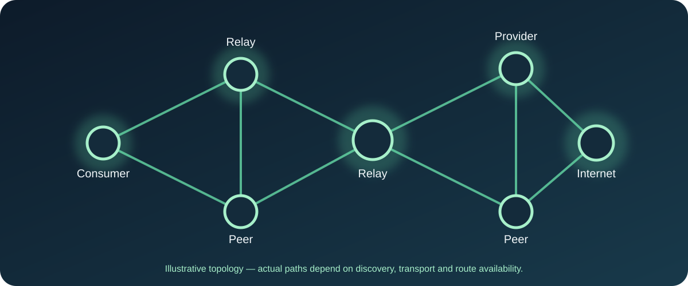
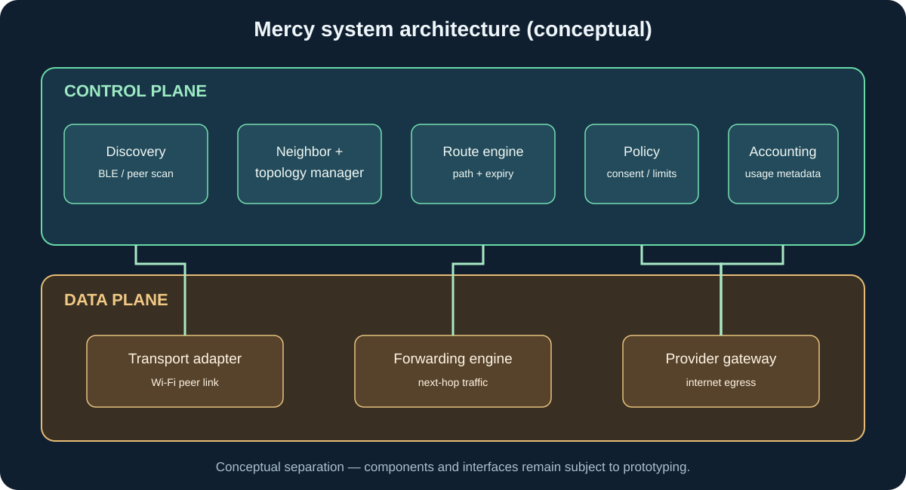
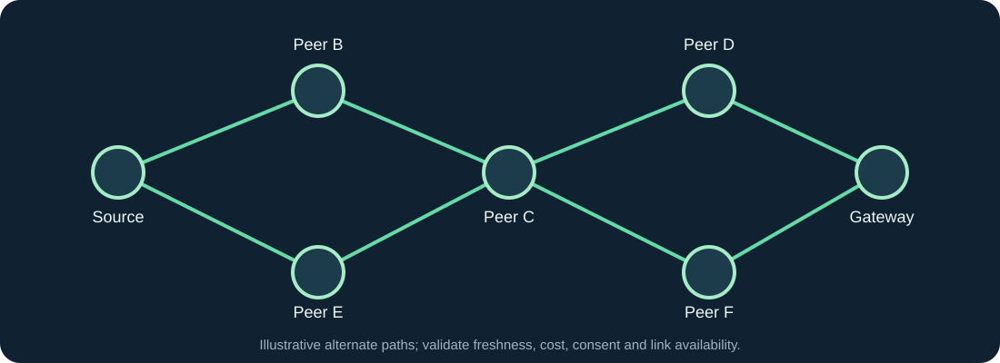
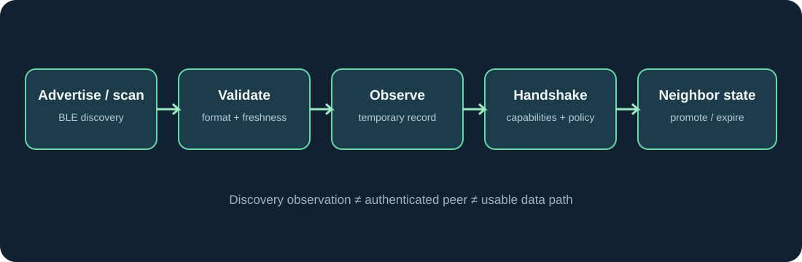

# Mercy — Technical Documentation

> Engineering notes for Mercy, a community-powered decentralized connectivity network.

  

**Branch:** `tech` · **Audience:** developers, systems engineers and technical reviewers.  
**Maturity:** architecture under design; implementation status is stated explicitly.

## 1. System goals

Mercy explores a device-to-device network that can discover peers, maintain direct-neighbor state, learn about remote nodes, select routes toward internet gateways, forward traffic over suitable transports, and apply consent, resource policies and usage accounting.

The architecture separates the **control plane** (discovery, metadata exchange, route computation and policy) from the **data plane** (user traffic forwarding).

## 2. High-level architecture

### Control plane
- **Discovery agent:** advertises and scans for nearby Mercy participants.
- **Peer handshake:** exchanges node identity, capabilities, role availability, protocol version and freshness data.
- **Neighbor manager:** tracks direct links and their state.
- **Topology manager:** maintains known network nodes and learned reachability.
- **Route engine:** selects and expires paths toward destination nodes or internet gateways.
- **Policy engine:** checks opt-in state, device constraints and provider rules.
- **Accounting agent:** records session and byte counters without inspecting application payloads.

### Data plane
- **Transport adapter:** establishes a usable link over a supported transport.
- **Forwarding engine:** passes packets or framed traffic to the next hop.
- **Gateway adapter:** provides controlled egress through an opted-in internet connection.
- **Usage meter:** counts ingress/egress bytes per session and participant.

A discovery radio is not automatically a traffic transport. BLE is appropriate for low-volume discovery and control messages; it should not be treated as the default bearer for internet traffic.

## 3. Node roles and capabilities

Roles are capabilities, not mutually exclusive device types.

| Role | Capability | Required condition |
|---|---|---|
| Consumer | Requests a path to an internet gateway | User requests/permits connectivity |
| Relay | Forwards traffic for another node | Explicit relay opt-in and policy approval |
| Provider | Offers internet egress | Explicit provider opt-in and usable uplink |
| Discovery participant | Announces or discovers nearby peers | Discovery permission and radio availability |

A node can be a provider and relay, or consumer and relay, if the platform and user policy allow it. Role state must be exchanged as capability metadata, not inferred from installation.

## 4. Discovery and neighbor management

BLE can discover nearby peers and exchange compact control-plane messages. Discovery should account for pseudonymous identifiers, replay protection, protocol versioning, message-size limits and stale-record expiry.

A successful BLE discovery does not prove that a peer can forward internet traffic. A separate capability negotiation must establish whether a compatible data transport is available.

Suggested peer handshake fields:

| Field | Purpose |
|---|---|
| `protocol_version` | Compatibility negotiation |
| `node_id` | Pseudonymous node identifier |
| `capabilities` | Supported discovery and transport features |
| `roles_available` | Consumer, relay and/or provider capabilities |
| `policy_flags` | Share/relay availability without exposing private settings |
| `link_metrics` | Signal and link quality observations |
| `sequence` | Replay and freshness handling |
| `timestamp` / `expires_at` | Record freshness |
| `signature` / authentication proof | Verify message origin where supported |

A node identifier is not proof of identity. Authentication and trust establishment require a separate security design.

## 5. Data model: separate what is observed from what is learned

The five logical tables are documented in [Network data models](docs/network-data-model.md). They are conceptual views, not a finalized persistence schema.

| Table | What it represents |
|---|---|
| Discovery table | Short-lived observations from scans and advertisements |
| Neighbor table | Current direct peer relationships |
| Neighbor routing table | Routes whose next hop is a direct neighbor |
| Known network nodes | Topology knowledge about direct and remote nodes |
| Known network nodes routing table | Candidate paths through the wider network |

**Key distinction:** discovery is an observation; a neighbor is a direct peer relationship; a known node is topology knowledge; a route is a forwarding decision. Do not collapse these into one table.

## 6. Routing model

The routing algorithm is not finalized. A viable design must address route freshness and expiry, link quality and transport availability, hop count and accumulated cost, loop prevention, duplicate advertisements and replay, route withdrawal, gateway availability and provider consent, and resource constraints.

A route score may combine normalized metrics such as hop count, link quality, expected throughput, reliability, latency and resource cost. Do not choose weights until measurements exist.

For early prototypes, use deterministic and explainable route selection before introducing complex optimization. Every route should have a reason, freshness value and invalidation rule.

## 7. Transport strategy

### BLE
Use BLE for nearby discovery, small peer advertisements, capability and policy negotiation, and route/control messages where appropriate. Do not assume BLE offers the bandwidth, MTU, latency or platform behavior required for general IP forwarding.

### Wi-Fi peer transports
Evaluate platform-supported options such as Wi-Fi Direct and Wi-Fi Aware where available. Support varies by device, Android version, hardware and API access. The transport abstraction should allow multiple implementations rather than hard-coding one radio technology.

### Internet gateway
A provider needs a controlled method to expose an uplink to the Mercy network. Android networking, tethering restrictions, VPN APIs, carrier terms, background execution limits and local network policies must be investigated. Do not assume an ordinary app can transparently share arbitrary cellular traffic on every device.

## 8. Data processing lifecycle

1. Scan and receive a peer advertisement.
2. Validate message format, protocol version and freshness.
3. Store a short-lived discovery observation.
4. Perform peer handshake and capability negotiation.
5. Promote the peer to the neighbor view only after required checks.
6. Process route advertisements and update known-node topology.
7. Compute or refresh candidate routes.
8. Apply user consent and resource policy before selecting a route.
9. Establish the data transport and forwarding session.
10. Meter bytes and session metadata; expire stale state.

## 9. Permissions, consent and resource policy

Permission requirements are platform/version-specific. For Android, likely areas include Bluetooth scan/connect/advertise, nearby Wi-Fi capabilities, location where required by platform/API version, foreground services, notifications, and network state/access. Exact manifest declarations must follow the actual APIs used and current Android SDK rules.

**Permission is not consent.** The app must separately record user choices for peer discovery, relaying traffic, providing an internet uplink, cellular-data contribution and background operation.

Example policy inputs include cellular data budget, Wi-Fi-only provider mode, battery and thermal state, user pause/stop state, link quality, expected throughput, and provider/relay availability.

## 10. Security and privacy requirements

Security design is a prerequisite for carrying real user traffic.

- Authenticate control messages and protect against replay.
- Use end-to-end encryption for user traffic where the application protocol supports it; relays should not need to inspect payload content.
- Separate node identifiers from real-world identity.
- Minimize retained metadata and define retention periods.
- Prevent unauthorized use of a provider's connection.
- Rate-limit discovery and control messages.
- Protect accounting records against tampering and duplicate claims.
- Define abuse handling, blocking and revocation.
- Document threat models before any public network trial.

## 11. Mercy contribution accounting

The Mercy points/credit concept is exploratory. A future accounting system could consider verified bytes, session duration, role, reliability and policy eligibility. It must avoid rewarding fabricated traffic, collusion, replayed usage reports or low-quality routes. No final reward rate or redemption value is defined.

## 12. Development roadmap

| Stage | Focus | Exit criteria |
|---|---|---|
| 1 | Discovery prototype | Devices discover and identify peers reliably |
| 2 | Neighbor state | Direct neighbor records update and expire correctly |
| 3 | Topology exchange | Nodes learn about non-neighbor nodes |
| 4 | Route computation | Routes are explainable, loop-safe and expire |
| 5 | Transport prototype | Two peers exchange test payloads over supported Wi-Fi transport |
| 6 | Multi-hop forwarding | Traffic crosses at least one intermediate relay |
| 7 | Gateway prototype | A consenting provider offers controlled internet egress |
| 8 | Policy and accounting | Opt-in, caps, pause and usage reporting work |
| 9 | Security and field testing | Threat review, device matrix and controlled pilot |

## 13. Contribution guidelines

When proposing a change, include the problem, affected layer (discovery, topology, routing, transport, gateway, policy or accounting), platform/device assumptions, failure and privacy implications, and a test plan with measurable acceptance criteria.

This branch is a living engineering document. Tables and algorithms are proposals until backed by code, tests and measurements. Do not describe a feature as implemented merely because it appears in this README.

---

**Mercy:** connectivity through cooperation.
