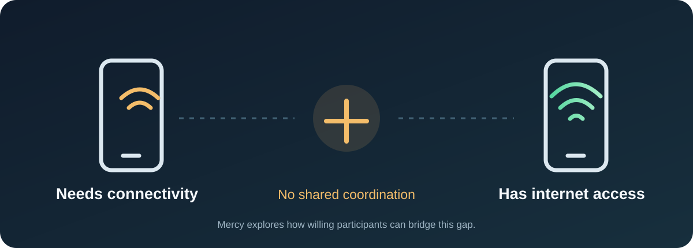
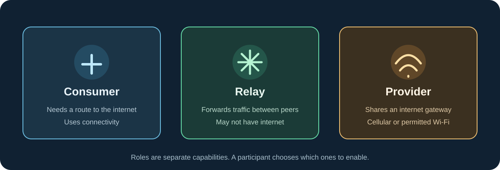
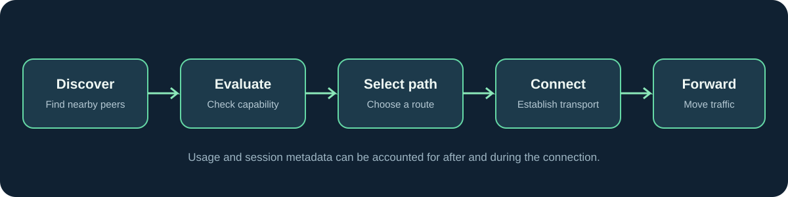

# Mercy

  

  <strong>A community-powered decentralized connectivity network.</strong> 
  Connectivity should not depend on one access point when a community can help connect itself.

  <a href="#the-problem">The problem</a> ·
  <a href="#the-idea">The idea</a> ·
  <a href="#how-mercy-works">How it works</a> ·
  <a href="#privacy-permissions--control">Privacy & permissions</a> ·
  <a href="#project-status">Project status</a>

---

## The problem

Imagine you're on campus. Your data bundle is almost finished, campus Wi-Fi is unreliable or unavailable where you are, and someone a short distance away has a working internet connection they are willing to share.

Today, those two people usually remain disconnected from each other. Their devices have radios and network capabilities, but there is no shared system coordinating discovery, consent, and traffic forwarding between them.

That is the gap Mercy is exploring.

  

## The idea

**Mercy is a community-powered connectivity network.**

The project explores how nearby devices can discover one another and cooperate to extend access to an internet connection. A device with connectivity may voluntarily provide an internet gateway. Other devices may help relay traffic across the network so that a user who is not directly within range of the gateway can still reach it.

A Mercy network is made of participating devices, not one central access point.

The goal is to make connectivity sharing:
- **Voluntary:** people decide whether their device can relay traffic or provide internet access.
- **Visible:** participants can understand when their device is contributing and how much data is involved.
- **Controlled:** users can set limits, pause participation, and withdraw consent.
- **Resilient:** the network can discover alternate peers and paths when the topology changes.
- **Privacy-conscious:** network coordination should not require reading the content of users' traffic.

## How Mercy works

Mercy separates participation into two main roles. A device can take on more than one role when its owner allows it.

  

### 1. Consumer — needs connectivity

A consumer is a participant looking for a route to the internet. Mercy can discover nearby participating devices and determine whether a usable path to an internet provider exists.

### 2. Relay — helps move traffic

A relay forwards traffic between participating devices. It does not necessarily have its own internet connection. Relaying uses device resources, so it must be separately enabled and governed by limits such as battery, connection quality, and data or resource policies.

### 3. Provider — shares an internet connection

A provider makes an existing internet connection available to the Mercy network. That connection could be cellular data or a Wi-Fi connection whose owner and network rules permit sharing.

A provider is not automatically a relay, and a relay is not automatically a provider. These are separate capabilities and consent decisions.

### A typical connection

1. **Discover:** devices advertise and scan for nearby Mercy participants using supported discovery technologies.
2. **Evaluate:** peers exchange the minimum information needed to understand availability, capabilities, link quality, and participation rules.
3. **Select a path:** the network evaluates direct neighbors and known routes toward an available provider.
4. **Connect:** the participating devices establish an appropriate data path using a supported transport.
5. **Forward:** traffic is relayed toward the provider, which gives the traffic access to the internet.
6. **Account:** Mercy records relevant usage and network metadata so participants can see resource consumption and apply limits.

  

**Important:** Bluetooth Low Energy (BLE) is useful for nearby discovery and exchanging small control messages. BLE by itself is not intended to carry ordinary internet traffic at useful broadband speeds. Data forwarding requires a suitable transport, such as a supported Wi-Fi peer-to-peer or local network connection. The exact transport strategy is still being evaluated.

## Participation is a choice

Installing Mercy must not silently turn a person's phone into a public internet gateway. Participation is based on clear, separate choices.

| Capability | What it means | User control |
|---|---|---|
| Discover peers | Find nearby Mercy devices | Enable/disable discovery |
| Relay traffic | Forward traffic for another participant | Separate opt-in and resource limits |
| Provide internet | Share an available internet connection | Separate opt-in, data limits and pause |
| Consume connectivity | Use a route provided by the network | Connect only when a usable route is available |

A device may be discoverable without agreeing to relay traffic or provide internet access.

## Privacy, permissions & control

Mercy needs certain device capabilities to discover peers and manage network connections. The exact permissions depend on the operating system, Android version, selected transport, and whether the app is running in the foreground or background.

Potential Android permissions and capabilities include:

| Permission / capability | Why it may be needed |
|---|---|
| Nearby devices / Bluetooth permissions | BLE scanning, advertising and nearby-device connections |
| Wi-Fi state and connection permissions | Check network state and use supported Wi-Fi transports |
| Location permission (where required by Android) | Some Android versions require location access for certain Wi-Fi/Bluetooth scanning operations |
| Foreground service | Keep a user-visible, active network task running when required |
| Notifications | Show active participation, connection status and controls |
| Network / internet access | Communicate through an available network and provide connectivity features |

Mercy should request permissions when the related feature is introduced, explain the reason in plain language, and handle denial gracefully. Permission grants are not a substitute for consent to relay or provide internet.

### What information may be processed?

The network needs operational metadata to discover peers, select routes, protect participants, and account for resource usage. Depending on the feature enabled, this may include:

- A pseudonymous Mercy node identifier.
- Discovery timestamps and nearby peer identifiers.
- Supported capabilities and participation preferences.
- Link-quality indicators such as signal strength and connection state.
- Route information, hop count, and route expiry.
- Bytes transferred and session duration.
- Provider availability and the type of connection being offered.
- Usage limits and accounting records.

**The intended design is to avoid collecting the contents of users' internet traffic.** Traffic content should be protected in transit, and routing/accounting should rely on the minimum metadata needed to operate the network. The exact encryption, retention, and abuse-prevention policies must be specified and reviewed before real users' traffic is carried.

### User controls we intend to support

- Pause or stop discovery.
- Independently enable or disable relaying.
- Independently enable or disable internet provision.
- Set daily or session-based cellular-data limits.
- View active sessions and data contributed or consumed.
- Stop sharing immediately.
- Choose whether participation is allowed on battery, charging, Wi-Fi, or cellular conditions.

These are design goals, not claims that every control is already implemented.

## Mercy accounting

Mercy is exploring a contribution-accounting model for participants who voluntarily provide resources. The working concept is to recognise eligible contributions through a points or credit system referred to as **Mercy**.

The accounting model must be transparent and resistant to abuse. It needs to define eligible contribution types, measurement, verification, limits, redemption, and dispute handling. No monetary value, guaranteed reward, or final exchange rate is being promised at this stage.

## What Mercy is — and is not

**Mercy is:**
- An exploration of community-powered connectivity.
- A decentralized peer discovery and routing concept.
- A system where relaying and providing connectivity are separate opt-in roles.
- A project that prioritises user control and transparent resource accounting.

**Mercy is not yet:**
- A production-ready mesh internet service.
- A guarantee of internet availability or speed.
- A replacement for mobile network operators or internet service providers.
- A promise that every phone supports every discovery or transport feature.
- A finished rewards or payments platform.

## Project status

  
<strong>Current development stage</strong>

  Mercy is in the design and prototyping stage. The project is exploring peer discovery, neighbor tracking, multi-hop route knowledge, transport options, user consent, and resource accounting.

  Architecture and implementation details are evolving. Proposed capabilities are labelled as such until they have been implemented and tested on supported devices.

| Area | Status |
|---|---|
| Core concept and participation roles | Defined |
| Discovery and neighbor data model | Under design |
| Multi-hop route model | Under design |
| Data transport strategy | Under evaluation |
| Permission and consent model | Under design |
| Usage accounting / Mercy credits | Under design |
| Production deployment | Not available |

## Get involved

Mercy is being developed in the open. Feedback from potential users and developers will help challenge assumptions before they become implementation decisions.

- Open an [issue](https://github.com/prim5v/mercy-bundle/issues) to discuss a problem, question, or proposal.
- Explore the [technical documentation](https://github.com/prim5v/mercy-bundle/tree/tech) for architecture and data-model details.
- Contributions and constructive criticism are welcome.

## Documentation

- **User-facing overview:** this README on `main`.
- **Technical overview:** [README on the `tech` branch](https://github.com/prim5v/mercy-bundle/tree/tech).
- **Technical architecture and data models:** see the `docs/` directory on `tech`.

---

  <strong>Mercy — connectivity through cooperation.</strong> 
  An evolving open project. Design proposals may change as they are tested.

